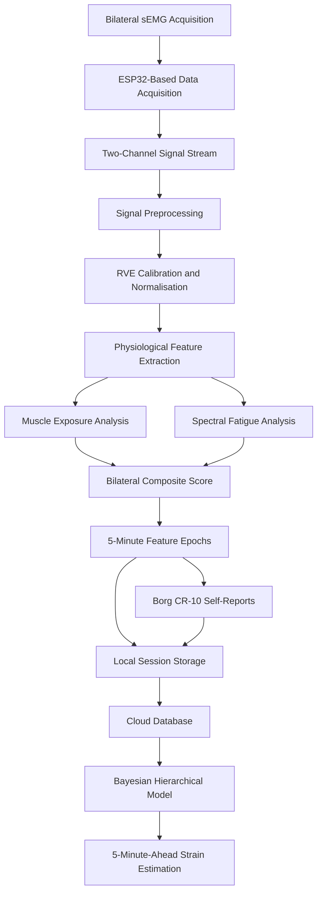

# BioEcho
### A Bilateral sEMG-Based System for Monitoring Upper-Trapezius Muscle Activity and Forecasting Muscular Strain

BioEcho is an interdisciplinary research project combining **biomedical signal processing, machine learning, statistical modelling, and embedded electronics** to study muscular activity and fatigue in the upper trapezius.

The project investigates whether patterns in bilateral surface electromyography (sEMG) signals can help identify sustained muscle loading, fatigue-related changes, and developing muscular strain during prolonged desk-based activities.

Rather than relying exclusively on subjective pain reports, BioEcho combines continuous physiological measurements with periodic self-reported strain ratings. The objective is to develop a personalised model capable of estimating a user's perceived muscular strain approximately five minutes ahead.

The research brings together human-participant data collection, physiological signal analysis, embedded data acquisition, and hierarchical Bayesian modelling.

---

## Table of Contents

- [Research Objectives](#research-objectives)
- [System Overview](#system-overview)
- [Research Methodology](#research-methodology)
- [Signal Processing Pipeline](#signal-processing-pipeline)
- [Muscle Activity and Exposure Analysis](#muscle-activity-and-exposure-analysis)
- [Bayesian Machine Learning Model](#bayesian-machine-learning-model)
- [Data Collection and Storage](#data-collection-and-storage)
- [Technology Stack](#technology-stack)
- [Repository Structure](#repository-structure)
- [Getting Started](#getting-started)
- [Running the Application](#running-the-application)
- [Model Training](#model-training)
- [Testing](#testing)
- [Research Considerations and Limitations](#research-considerations-and-limitations)
- [Contributors](#contributors)

---

## Research Objectives

BioEcho investigates the relationship between muscular electrical activity and perceived muscular strain, with particular attention to the upper trapezius.

The main research objectives are:

1. **Continuous muscle activity monitoring:** Acquire bilateral sEMG signals and analyse changes in muscle activity over time.

2. **Physiological feature extraction:** Extract interpretable time-domain and frequency-domain features associated with muscle loading, relaxation, and fatigue.

3. **Muscle exposure analysis:** Study the duration, frequency, and distribution of sustained muscle contractions rather than relying on signal amplitude alone.

4. **Personalised modelling:** Account for differences in baseline muscle activity and individual responses using a hierarchical statistical model.

5. **Strain forecasting:** Investigate whether physiological measurements collected at time \(t\) can estimate a participant's subjective strain at \(t+5\) minutes.

6. **Uncertainty-aware predictions:** Use Bayesian inference to represent uncertainty in predictions rather than treating every estimate as equally reliable.

## System Overview

BioEcho is organised into five interconnected components.

| Component | Purpose |
|---|---|
| Embedded acquisition | Acquire bilateral sEMG measurements using the wearable electronics |
| Signal processing | Filter, rectify, normalise, and extract muscle activity features |
| Physiological analysis | Quantify muscle loading, relaxation, asymmetry, and spectral changes |
| Data management | Store participant profiles, sessions, raw measurements, and derived features |
| Statistical modelling | Estimate future subjective muscular strain using hierarchical Bayesian regression |

### High-Level Architecture



The acquisition electronics and software are developed as part of the same research system. The ESP32-based hardware represents the current hardware direction. The checked-in Python acquisition adapter still contains an earlier serial-stream implementation, so its transport interface must be aligned with the current ESP32 firmware before using it for live acquisition. Offline CSV analysis and replay are supported independently.

---

## Research Methodology

BioEcho uses a multi-stage physiological data analysis pipeline.

### 1. Bilateral sEMG Acquisition

Surface EMG measurements are collected from the left and right upper-trapezius muscles.

The bilateral arrangement allows the system to study:

- Muscle activity on each side independently.
- Differences in left and right muscle loading.
- Changes in activity throughout a working session.
- Relationships between muscular activity and reported strain.

The acquisition system is designed around two independent sEMG channels and a shared reference.

The study's data collection has involved **40 participants**. Participant measurements and subjective reports form the basis for examining individual variability in muscular activity.

### 2. Reference Voluntary Exertion Calibration

Raw EMG amplitudes vary between participants and electrode placements.

BioEcho therefore uses Reference Voluntary Exertion (RVE) calibration to establish an individual reference level for each channel.

The current software implementation uses a five-second calibration recording and extracts a stable middle portion of the recording to calculate the reference RMS value.

Left and right channels are calibrated independently.

This provides a participant-relative measure of muscle activity rather than relying exclusively on absolute signal amplitude.

---

## Signal Processing Pipeline

The processing pipeline is implemented in the `chordspy/tensionbudget/` package.

Each channel is processed independently before bilateral measurements are combined.

### Processing Stages

| Stage | Processing method | Purpose |
|---|---|---|
| 1 | Raw ADC conversion | Convert digital measurements into signal values |
| 2 | Butterworth bandpass filtering | Retain the selected EMG frequency range |
| 3 | Conditional notch filtering | Reduce confirmed mains-frequency interference |
| 4 | Full-wave rectification | Obtain the signal amplitude representation |
| 5 | Moving RMS extraction | Estimate muscle activity over short windows |
| 6 | RVE normalisation | Express activity relative to individual calibration |
| 7 | Time-domain analysis | Quantify contractions, relaxation periods, and activity distributions |
| 8 | Frequency-domain analysis | Estimate spectral characteristics associated with fatigue |

### Filtering

The current processing configuration uses:

- Sampling frequency: 500 Hz
- Bandpass lower cutoff: 20 Hz
- Bandpass upper cutoff: 240 Hz
- Filter: Fourth-order Butterworth
- Notch filtering: Automatically enabled when configured interference detection identifies a mains-frequency component

The upper cutoff is kept below the Nyquist frequency of the configured 500 Hz sampling rate.

### RMS Envelope

The current implementation uses:

- RMS window: 100 ms
- RMS step: 20 ms
- Overlap: 80%

The RMS envelope provides a smoothed representation of muscle activation suitable for subsequent exposure analysis.

### Streaming and Offline Processing

The processing package supports both:

- Incremental processing through `StreamingChannelProcessor`.
- Offline processing of previously recorded CSV sessions.

This allows the same general processing methodology to be used for live monitoring and retrospective analysis.

---

## Muscle Activity and Exposure Analysis

A central part of BioEcho is the extraction of features that describe how muscles are used over time.

The system does not treat muscle activity as a single amplitude value. Instead, it examines the distribution and duration of contractions, relaxation periods, and changes in spectral characteristics.

### 1. Relaxation Gap Detection

Relaxation periods are identified using a threshold on normalised muscle activity.

The current configuration defines:

- Relaxation threshold: below 3% RVE
- Minimum relaxation duration: 125 ms

The system extracts individual relaxation intervals and calculates:

- Number of detected gaps.
- Duration of each gap.
- Total relaxation time.
- Gap frequency.

These measurements help describe how frequently a muscle relaxes during a session.

### 2. Sustained Muscle Activity Analysis

BioEcho implements SUMA-style sustained muscle activity detection.

An activity event is identified when normalised activity exceeds the configured 0.5% RVE threshold for at least 1.5 seconds.

Detected events are grouped into duration categories:

| Duration category |
|---|
| 1.5–5 seconds |
| 5–10 seconds |
| 10–20 seconds |
| 20–60 seconds |
| 1–2 minutes |
| 2–4 minutes |
| 4–8 minutes |
| 8–10 minutes |
| 10–20 minutes |
| More than 20 minutes |

A particular focus is placed on short-duration sustained contractions.

The project investigates the frequency of these short events as a potential contributor to muscular loading, extending the exposure analysis beyond the proportion of time spent under load.

### 3. Amplitude Probability Distribution Function

The Amplitude Probability Distribution Function (APDF) describes the distribution of muscle activity over a measurement period.

BioEcho calculates:

- APDF-10: Lower activity percentile.
- APDF-50: Median activity percentile.
- APDF-90: Higher activity percentile.

Both session-level and active-period distributions are calculated.

The active APDF excludes samples below the configured resting threshold. This helps distinguish periods of active muscle loading from periods of relaxation.

### 4. Bilateral Asymmetry Analysis

BioEcho calculates a signed Laterality Index using the median active APDF values of the two channels.

\[
AI =
\frac{APDF50_R-APDF50_L}
{APDF50_R+APDF50_L}
\]

Where:

- \(AI=-1\): Left-dominant activity.
- \(AI=0\): Symmetric activity.
- \(AI=+1\): Right-dominant activity.

This is a project-specific metric used to quantify differences between left and right trapezius activity.

### 5. Spectral Fatigue Analysis

BioEcho uses Welch's Power Spectral Density (PSD) estimation to examine changes in the frequency characteristics of the EMG signal.

The analysis includes:

- Median Power Frequency (MDF).
- Mean Power Frequency (MNF).
- Linear regression of MDF over time.
- Coefficient of determination (\(R^2\)).
- Number of valid spectral windows.
- Fatigue-trend flag.

The configured spectral analysis uses one-second windows with 50% overlap.

**Important:** Spectral calculations use the bandpass-filtered signal before rectification. Rectification can introduce harmonics that distort frequency-domain measurements.

The current implementation uses a 20–240 Hz passband because of the 500 Hz sampling configuration. Consequently, absolute MDF/MNF values should be interpreted as internal session trends and not directly compared with studies using a wider 20–450 Hz passband.

---

## Composite Muscle Exposure Score

BioEcho combines exposure-related measurements into a bilateral composite score.

The scoring system uses two main components.

### Exposure Index (EIndex)

The exposure index follows the three-category exposure formulation:

\[
EIndex=-2P_{Rest}+P_{Low}+2P_{High}
\]

Where:

- \(P_{Rest}\): Proportion of samples below 0.5%.
- \(P_{Low}\): Proportion of samples between 0.5% and 7%.
- \(P_{High}\): Proportion of samples at or above 7%.

The proportions are calculated independently for each side.

The index is bounded between -2 and +2.

### Short-SUMA Frequency Component

The short-SUMA component counts events belonging to the 1.5–5 second and 5–10 second duration categories.

The implemented calculation is:

\[
Penalty=\min(0.1N_{short},1.0)
\]

Where \(N_{short}\) is the number of qualifying short-duration events.

This is a project-specific extension of the exposure analysis, not a formula directly supplied by the underlying literature.

### Per-Side Score

The two components are combined:

\[
Score_{side}=EIndex_{side}+Penalty_{side}
\]

### Bilateral Fusion

The higher per-side score represents the more heavily loaded side.

The composite score therefore uses:

\[
BaseScore=\max(Score_L,Score_R)
\]

An additional asymmetry penalty is applied when the absolute Laterality Index exceeds the configured threshold of 0.5.

The current penalty is 0.25 points.

The analytical composite score is retained without flooring its negative values. A separate display transformation is used for the application's visual representation.

The exposure score is a research metric and should not be interpreted as a clinically validated measurement of pain or injury risk.

---

## Bayesian Machine Learning Model

An important research component of BioEcho is the estimation of subjective muscular strain five minutes into the future.

The model uses physiological features extracted from the preceding measurement period together with participant-specific information.

### Prediction Objective

The target variable is:

`subjective_strain_cr10_t_plus_5min`

The target represents a participant's reported muscular strain approximately five minutes after the predictor measurements.

Subjective strain is collected using the Borg CR-10 scale, ranging from 0 to 10.

The application records self-reported values at five-minute intervals and allows participants to skip reporting when necessary.

Missing reports are stored as missing values rather than being replaced with artificial numerical labels.

### Hierarchical Bayesian Regression

The main research implementation uses PyMC to construct a hierarchical Bayesian regression model.

The model includes:

**Population-level intercept**

Represents the overall population baseline.

**Participant-specific random intercepts**

Account for differences in participants' baseline perceived strain.

**Population-level feature coefficients**

Represent the general relationship between physiological features and future strain.

**Participant-specific random slopes**

Allow physiological features to have different effects for different participants.

This structure provides partial pooling: participant-level estimates are informed by both individual observations and the broader population.

### Regularized Horseshoe Prior

The model uses a regularized Horseshoe prior for the population-level feature coefficients.

The purpose is to control overfitting and reduce the influence of weak or redundant predictors while retaining potentially informative features.

This is particularly relevant because several physiological features may be correlated.

### NUTS Sampling

Posterior distributions are estimated using Hamiltonian Monte Carlo with the No-U-Turn Sampler (NUTS).

The modelling workflow includes:

1. Dataset preparation and feature construction.
2. Prior predictive checks.
3. Bayesian hierarchical model construction.
4. NUTS sampling.
5. Convergence diagnostics.
6. Posterior predictive checks.
7. Leave-One-Subject-Out (LOSO) cross-validation.
8. Export of posterior summaries and model parameters.

Convergence is examined using R-hat, effective sample size, and divergent-transition counts.

The posterior distribution provides information about prediction uncertainty in addition to the predicted strain value.

### Research Validation Status

The repository contains a statistical report documenting an earlier model run with:

- 568 valid forecasting pairs.
- Six participants.
- Five-minute forecasting target.
- Hierarchical Bayesian regression.
- NUTS sampling.
- Regularized Horseshoe prior.

That report is an earlier modelling result and **does not represent validation on the complete 40-participant data collection**.

The number of participants involved in data collection must be distinguished from the number included in a particular training or validation run.

---

## Data Collection and Storage

BioEcho stores participant information, session metadata, raw physiological measurements, derived features, and subjective reports separately.

### Local Storage

The application organises sessions by participant.

The general structure is:

```text
output_logs/
│
├── participant_001/
│   ├── user_profile.json
│   │
│   ├── session_YYYYMMDD_HHMMSS/
│   │   ├── session_..._metadata.json
│   │   ├── session_..._features.csv
│   │   └── session_..._raw.parquet
│   │
│   └── session_YYYYMMDD_HHMMSS/
│       ├── session_..._metadata.json
│       ├── session_..._features.csv
│       └── session_..._raw.parquet
│
└── participant_002/
    └── ...
```

The raw measurement file is initially written as CSV and is converted to Parquet when session finalisation succeeds. If compression fails, the CSV is retained.

### Feature Logging

Feature data is recorded in five-minute epochs.

The stored measurements include:

- Left and right exposure indices.
- Cumulative exposure indices.
- Short-SUMA penalties.
- Sustained activity counts.
- Relaxation gap frequency.
- APDF-10, APDF-50, and APDF-90.
- Laterality Index.
- Asymmetry penalty information.
- MDF and MNF.
- Spectral fatigue slopes.
- Regression \(R^2\).
- Valid spectral window counts.
- Fatigue flags.
- Borg CR-10 self-reports.

Explicit reporting flags distinguish an unreported subjective rating from a genuine zero rating.

### Cloud Database

The repository includes a database layer designed to work with SQLite and PostgreSQL.

The database uses three principal tables:

| Table | Purpose |
|---|---|
| `user_profiles` | Participant profile information |
| `sessions` | Session metadata and calibration information |
| `epoch_features` | Five-minute physiological feature records and subjective strain labels |

A database view named `v_ml_training_pairs` combines the relevant profile, session, and feature information for machine learning.

The repository also contains a Supabase Edge Function for server-side ingestion.

Cloud synchronisation supports password verification and uses PBKDF2-HMAC-SHA256 password hashing. The Supabase service-role key must remain server-side and must never be included in the repository or exposed to the client.

---

## Technology Stack

### Embedded Systems and Signal Acquisition

- ESP32-based wearable acquisition hardware
- Bilateral surface electromyography (sEMG)
- Analog signal acquisition
- Two-channel physiological data collection

### Programming and Signal Processing

- Python
- NumPy
- SciPy
- Pandas
- PySerial
- Lab Streaming Layer (LSL)

### Signal Analysis

- Butterworth filtering
- Notch filtering
- Full-wave rectification
- Moving RMS
- RVE normalisation
- Welch PSD
- APDF
- Median and mean power frequency
- Linear regression

### Machine Learning and Statistics

- PyMC
- ArviZ
- Bayesian hierarchical regression
- Regularized Horseshoe prior
- Hamiltonian Monte Carlo
- NUTS sampling
- Posterior predictive checks
- Leave-One-Subject-Out cross-validation
- Scikit-learn

### Application and Visualisation

- PyQt5
- PyQtGraph

### Data Management and Cloud

- SQLite
- PostgreSQL
- Supabase
- Parquet
- JSON
- CSV

---

## Repository Structure

```text
BioEcho/
│
├── chordspy/
│   │
│   ├── tensionbudget/
│   │   ├── config.py
│   │   ├── recorder.py
│   │   ├── preprocessing.py
│   │   ├── calibration.py
│   │   ├── analytics.py
│   │   ├── spectral.py
│   │   ├── scoring.py
│   │   ├── session.py
│   │   ├── session_report.py
│   │   ├── local_logger.py
│   │   ├── cloud_schema.py
│   │   ├── cloud_ingest.py
│   │   │
│   │   └── tests/
│   │       ├── conftest.py
│   │       ├── test_all_38_features_integrity.py
│   │       ├── test_phase12_cloud_ingest.py
│   │       ├── test_phase12_spectral_epoch.py
│   │       ├── test_phase6_scoring.py
│   │       ├── test_phase7_spectral.py
│   │       └── test_phase8_app.py
│   │
│   └── tensionbudget_app.py
│
├── supabase/
│   └── functions/
│       └── ingest-session/
│           └── index.ts
│
├── scripts/
│   ├── export_postgres_ddl.py
│   ├── export_raw_to_excel.py
│   ├── ingest_to_postgres.py
│   ├── run_live_smoke_tests.py
│   ├── verify_password_gating.py
│   └── web_endpoint_server.py
│
├── mock_data/
│
├── train_pymc_hierarchical_model.py
├── train_bayesian_model.py
├── generate_statistical_report.py
├── inspect_dataset.py
├── start_lsl_stream.py
│
├── statistical_report.md
├── requirements.txt
├── pyproject.toml
├── LICENSE
└── README.md
```

---

## Getting Started

### Prerequisites

- Python 3.10 or later, below Python 3.14.
- Git.
- A compatible development environment.
- A two-channel LSL data source for live streaming, or recorded BioEcho-compatible CSV files for offline analysis.

### 1. Clone the Repository

```bash
git clone https://github.com/mkdev28/tension_budget_ipd.git
cd tension_budget_ipd
```

### 2. Create a Virtual Environment

```bash
python -m venv .venv
```

Activate the environment.

**Windows PowerShell:**

```powershell
.\.venv\Scripts\Activate.ps1
```

**macOS / Linux:**

```bash
source .venv/bin/activate
```

### 3. Install Dependencies

Upgrade pip:

```bash
python -m pip install --upgrade pip
```

Install the repository dependencies:

```bash
pip install -r requirements.txt
```

For the Bayesian research pipeline, install its additional modelling dependencies:

```bash
pip install pymc arviz scikit-learn
```

For running the test suite:

```bash
pip install pytest
```

---

## Running the Application

Launch the BioEcho monitoring application from the repository root:

```bash
python -m chordspy.tensionbudget_app
```

The application provides two input modes.

### Offline CSV Replay

1. Select **Offline CSV Replay Mode**.
2. Click **Select CSV File**.
3. Load a compatible raw recording.
4. Start replay.
5. Observe the bilateral signals and processed measurements.
6. Use the calibration and subjective reporting controls as appropriate for the session.

Offline replay allows the processing and analytical pipeline to be examined without connecting acquisition hardware.

### Live LSL Streaming

The application supports live acquisition through Lab Streaming Layer (LSL).

The current GUI expects a two-channel stream:

| LSL channel | Signal |
|---|---|
| Channel 0 | Left trapezius |
| Channel 1 | Right trapezius |

The live input adapter in the checked-in revision still uses the earlier serial acquisition implementation. The current ESP32 firmware and transport must be made compatible with the LSL publisher before live acquisition can be considered ready.

Do not assume that the older `start_lsl_stream.py` script is an ESP32 firmware uploader or an ESP32-compatible acquisition bridge.

---

## Model Training

The main Bayesian research implementation is:

```text
train_pymc_hierarchical_model.py
```

The training script expects a CSV export named:

```text
Supabase Snippet Untitled query.csv
```

in the repository root.

This dataset is not included in the public repository. Export the required training data from the research database and place it in the expected location before running the training script.

The training dataset must include the participant identifier, session identifier, epoch index, physiological predictor columns, and reported Borg CR-10 values used by the script.

The model preparation process:

1. Removes designated test accounts.
2. Retains epochs containing reported strain values.
3. Orders observations by session and epoch.
4. Constructs trend features from successive epochs.
5. Constructs the five-minute-ahead target from the next reported epoch.
6. Standardises predictor features.
7. Fits the hierarchical Bayesian model.
8. Evaluates posterior predictions and performs subject-level validation.
9. Exports model parameters and diagnostics.

Run the script:

```bash
python train_pymc_hierarchical_model.py
```

The model exports its posterior summaries and parameters to:

```text
tensionbudget_model_weights.json
```

**Dataset and evaluation considerations:**

- Only reported strain labels are used as supervised targets.
- The target is based on the next epoch within a session.
- The script assumes successive epochs correspond to the intended five-minute forecasting interval.
- The number of participants and labelled observations must be checked for each training run.
- Participant-level validation is important because observations from the same person are not statistically independent.

The separate `train_bayesian_model.py` file contains an earlier regularised Bayesian Ridge-based approach. It should not be confused with the PyMC hierarchical Horseshoe model.

---

## Testing

The repository includes tests for the principal signal-processing, scoring, spectral-analysis, application, and cloud-ingestion components.

Run the test suite from the repository root:

```bash
python -m pytest chordspy/tensionbudget/tests -q
```

The tests cover areas including:

- Feature extraction integrity.
- Signal-processing behaviour.
- Exposure scoring.
- Spectral calculations.
- Five-minute epoch handling.
- Cloud ingestion.
- Application functionality.

For hardware-independent development, mock data and offline CSV replay can be used to examine the processing pipeline.

Passing software tests does not establish the accuracy of physiological measurements or validate the model on unseen participants. Those require separate experimental validation.

---

## Research Considerations and Limitations

BioEcho is an ongoing research platform. Its current results and implementation should be interpreted in the context of the following limitations.

**1. Individual variability**

Muscle activity and subjective strain vary between participants. Hierarchical modelling is used to account for these differences, but broader participant-level validation remains important.

**2. Calibration dependence**

RVE normalisation depends on electrode placement, signal quality, and calibration consistency. Changes in these conditions can affect the derived features.

**3. Spectral passband**

The current 20–240 Hz spectral band is constrained by the configured 500 Hz sampling frequency. Absolute MDF/MNF values should not be treated as directly equivalent to results obtained using a 20–450 Hz passband.

**4. Heuristic parameters**

Some thresholds and scoring adjustments are engineering choices that require further evaluation against collected participant data.

**5. Model generalisation**

The statistical report currently present in the repository documents a six-participant modelling run. The collection of data from 40 participants should not be interpreted as evidence that the existing model has already been trained and validated on all 40.

**6. Clinical interpretation**

BioEcho is a research prototype. Its exposure scores and strain predictions are not clinically validated diagnostic measures and should not be used as a substitute for medical assessment.

**7. Hardware and software integration**

The project has moved towards ESP32-based acquisition. Some checked-in acquisition scripts and configuration comments still describe the earlier transport implementation. These components must remain synchronised with the current hardware firmware and channel mapping.

---

## Contributors

BioEcho is developed through collaboration across biomedical research, embedded systems, signal processing, software engineering, and machine learning.

- Lavish Jain
- Mohit Kankaria
- Kyra Karkaria
- Aryan Nallod Reddy
- Pratik Giya

---

## Acknowledgements

BioEcho incorporates and extends components from the open-source Chords-Python ecosystem for physiological signal acquisition and processing.

Original project: [Upside Down Labs – Chords-Python](https://github.com/upsidedownlabs/Chords-Python)

---

## Repository

[https://github.com/mkdev28/tension_budget_ipd](https://github.com/mkdev28/tension_budget_ipd)
